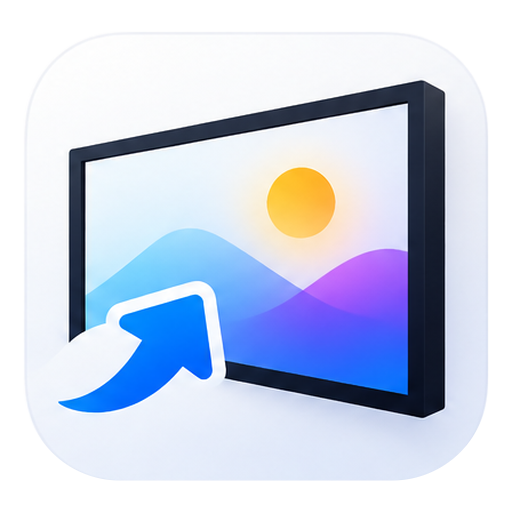

<p align="center">
  
</p>

<h1 align="center">Samsung The Frame Gallery Manager</h1>

An open-source desktop app for managing the **art gallery of a Samsung The Frame TV** from your computer: find the TV on your network, browse your photos, delete them, show one on the screen, and upload new photos cropped to the screen size. No Samsung account, no subscription, no cloud.

> **Status: early prototype.** It works end to end on a 2025 The Frame (Tizen), but it has been tried on a single TV. Expect rough edges.
>
> This is an independent project and is **not affiliated with or endorsed by Samsung**. "Samsung" and "The Frame" are trademarks of their owners.

## Features

- **Find your TV**: automatic discovery on the local network (SSDP), or add it by IP address.
- **Gallery**: thumbnails of your photos (optionally Art Store and factory images too, read-only).
- **Upload**: pick files or drag & drop them onto the gallery window, crop each one to the screen's 16:9 area, and the app sends a JPEG in the TV's native resolution (usually 3840×2160).
- **Right-click menu**: *Show on TV* and *Delete*. Deleting is limited to your own photos.
- **Self-healing connection**: the TV drops the Art Mode channel after about 100 s of inactivity; the app reconnects and retries on its own.
- **English and Polish** interface. The app follows the language of your system and falls back to English when there is no translation for it.

## Privacy and safety

- Talks **only to devices on your local network** (private IPv4 ranges); public addresses are rejected.
- The TV uses a self-signed certificate. Instead of disabling validation, the app **pins the certificate** (trust on first use) and refuses a different one later.
- The pairing token is stored **encrypted** (Windows DPAPI) in `%APPDATA%\FrameGallery\tvs.json`.
- No telemetry and no network traffic besides your TV. The only exception is the optional .NET runtime download that the bootstrapper offers (from Microsoft) when the runtime is missing.
- Diagnostic logs (`logs\log.txt` next to the executable) are always in English and contain the raw protocol traffic with **secrets masked** (tokens, keys, SSID, MAC), so a log can be attached to a bug report.

## Getting started

Download the latest `FrameGallery-<version>-win.zip` from the [Releases](../../releases) page, unzip it anywhere and run `FrameGallery.App.exe`. There is nothing to install and the package is only four files, which must stay together: the launcher `FrameGallery.App.exe` with its `FrameGallery.App.exe.config`, the application `FrameGallery.App.dll` (the libraries, translations and debug symbols are merged into it) and `FrameGallery.App.runtimeconfig.json`. Verify the download with the `.sha256` file next to it if you like.

Requirements: Windows 10/11 and the **.NET 10 Desktop Runtime**. The executable is wrapped by [DotnetRuntimeBootstrapper](https://github.com/Tyrrrz/DotnetRuntimeBootstrapper), which offers to install a missing runtime on first launch.

1. Make sure the computer and the TV are on the same network and the TV is on.
2. Start the app and click **Find TVs** (*Szukaj TV* in Polish), or **Add by IP…**.
3. Double-click the TV. On the first connection the TV asks you to **allow** the app; confirm with the remote.
4. Use the gallery. Right-click a photo for *Show on TV* / *Delete*, or drop image files onto the window to upload them.

If discovery finds nothing, the Windows firewall may be blocking the replies; add the TV by IP instead.

### Language

The language follows your system. To force one (for testing or a bug report), set the `FRAMEGALLERY_LANG` environment variable, for example `pl` or `en`, before starting the app.

## Building from source

Requires the [.NET 10 SDK](https://dotnet.microsoft.com/download).

```bash
dotnet build FrameGallery.slnx
dotnet test tests/FrameGallery.Tests
dotnet run --project src/FrameGallery.App
```

Packages come from nuget.org only (see `nuget.config`). At build time [Binternal](https://github.com/Tyrrrz/Binternal) merges the `Core` and `Localization` projects into `FrameGallery.App.dll` as internal types, debug symbols are embedded in the assemblies and the translations are compiled into the main assembly, which is why the published app has so few files. The bootstrapper is generated on every build; to debug the app, build with `-p:GenerateBootstrapperOnBuild=false` because the bootstrapper host does not support debugging.

### Repository layout

| Path | What it is |
|---|---|
| `src/FrameGallery.Core` | Platform-independent protocol client: SSDP discovery, REST device info, WebSocket channels, Art Mode requests, certificate pinning, paired-TV store with pluggable secret protection. Targets `net8.0` and `net10.0`, no UI or native dependencies. |
| `src/FrameGallery.Imaging` | Load, crop and JPEG encoding on [SkiaSharp](https://github.com/mono/SkiaSharp), usable on Windows, macOS and Linux. |
| `src/FrameGallery.Localization` | User-facing text as `.resx` resources: `Strings.resx` is English (the neutral fallback), `Strings.pl.resx` is Polish. |
| `src/FrameGallery.App` | WinForms prototype (Windows only). `Core` and `Localization` are merged into its assembly at build time. |
| `assets/icon` | The application icon: `source.png` (the original artwork), `icon.png` (the same with a transparent background) and `AppIcon.ico` (7 sizes, 16 to 256 px). |
| `tools/FrameGallery.Probe` | Console diagnostics for the protocol. `scan`, `list`, `idle` and `prepare` only read from the TV (or do not touch it); **`roundtrip` uploads and then deletes a test image, and `select` changes what the TV displays**. |
| `tests` | Unit tests (discovery, protocol parsing, crop math, store, log redaction, imaging, translations). |

### The application icon

`AppIcon.ico` is embedded in the executable once, through `ApplicationIcon` in the project file, and the windows read it back from the executable, so it is never embedded twice. `source.png` has no alpha channel, so `icon.png` and `AppIcon.ico` are generated from it (the transparent background is rebuilt from the tile's geometry). To regenerate them after changing the artwork, run this from the repository root:

```bash
dotnet run assets/icon/BuildIcon.cs
```

### Adding a language

1. Copy `src/FrameGallery.Localization/Strings.pl.resx` to `Strings.<culture>.resx` (for example `Strings.de.resx`) and translate the values. Keep the keys and the `{0}`-style placeholders unchanged.
2. Run the tests: they check that every key is translated and that the placeholders match.

### Making a release

Versions follow [Semantic Versioning](https://semver.org) and the changelog follows [Keep a Changelog](https://keepachangelog.com). The version lives in one place, `Directory.Build.props`, and the tag is the version itself, **without a leading `v`** (`0.2.0`, or `0.2.0-rc.1` for a pre-release).

1. Set the new `<Version>` in `Directory.Build.props`.
2. In `CHANGELOG.md` turn the `[Unreleased]` entries into a `## [0.2.0] - YYYY-MM-DD` section, add a fresh empty `[Unreleased]` above it and update the link references at the bottom.
3. Merge the change into `main`.
4. In GitHub go to **Actions → Release → Run workflow** and enter the tag `0.2.0`.

The workflow refuses a tag that is not a semantic version, does not match the version or already exists, and refuses a release whose changelog section is missing or empty. Then it runs the tests, publishes the app, creates the tag and a GitHub release and attaches `FrameGallery-0.2.0-win.zip` together with its SHA-256 checksum. The release notes are the changelog section plus a link comparing it with the previous release; a tag with a suffix such as `-rc.1` is marked as a pre-release. Releases are made from `main` only.

## Roadmap

- Cross-platform UI with [Avalonia](https://avaloniaui.net/) for Windows, macOS and Linux (replacing the WinForms prototype; work in progress), with CI and portable releases for every platform. Mobile is out of scope: Samsung already offers an official app.
- Portrait orientation, matte (passe-partout) selection, slideshow settings.
- More languages (see *Adding a language*).

## How the protocol was learned

Samsung's Art Mode interface is **undocumented**, so it may change with TV firmware updates. This project is an independent implementation, based on observing the traffic of a real TV and on the work of the community, for example [xchwarze/samsung-tv-ws-api](https://github.com/xchwarze/samsung-tv-ws-api) and [NickWaterton/samsung-tv-ws-api](https://github.com/NickWaterton/samsung-tv-ws-api). Please check their licenses before reusing any of their code.

## Contributing

Issues and pull requests are welcome. Add a line under `[Unreleased]` in [`CHANGELOG.md`](CHANGELOG.md) for every user-visible change. For bug reports, please attach `logs\log.txt` (secrets are masked, but skim it before sharing) and mention the TV model and year. Reports from other Frame models are especially valuable. Code, comments, logs and error messages are written in English; user-facing text goes into the resource files.

## License

[MIT](LICENSE)
